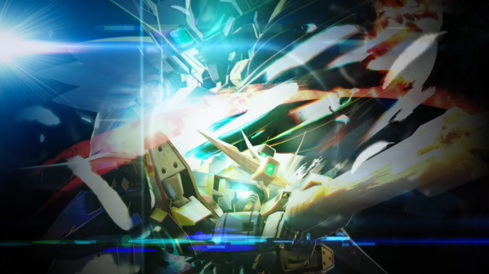

# SD Gundam G Generation Cross Rays — native iOS / macOS port

The Switch release of *SD Gundam G Generation Cross Rays* Platinum Edition (31 DLC included) running
natively on iPhone, iPad and Apple silicon Macs. **Not an emulator**: the game's own arm64 program
executes directly on the Apple chip, only the handful of instructions Apple's kernel cannot run are
rewritten, Horizon's system services are replaced by a host written for Apple platforms, and NVN is
rebuilt on Metal.

**Bring your own game files.** Nothing from any game is in this repository.

中文: [README.zh-CN.md](README.zh-CN.md)

<p align="center">
  
</p>

---

## Status

| Platform | |
|---|---|
| iPhone 16 Pro (A18 Pro, iOS 27.2) | ✅ played and accepted |
| Mac (Apple silicon, macOS 27.2) | ✅ played and accepted |
| Game version | 1.6.3 (v720896) + 31 DLC |

- 60 fps, no dropped frames (frame time p50 16.66 ms, p95 16.79 ms)
- Memory footprint: about 1.8 GB on the Mac, 1.3 GB on the phone
- Every screen drawn correctly: title, menus, battles, textures, effects
- Audio works
- Touch controls with the full button set, and the picture can fill the screen

---

## Playing

```bash
# Once:
#   - your own prod.keys
#   - Xcode 27.2 with `xcodebuild -downloadComponent MetalToolchain`
#   - the game, as an .xci or a folder of .nsp files

# Survey the title (optional, 45 s)
./run_nxnative.sh Game -k keys/prod.keys --survey-only

# Run it on the Mac
./run_nxnative.sh Game -k keys/prod.keys --platform mac
./play.sh

# Build an iPhone app (game data kept out of the app: 20 GB does not sideload)
./run_nxnative.sh Game -k keys/prod.keys --romfs separate --prepare-xcode --team-id <TEAM_ID>
```

The full procedure is [docs/PORTING-WORKFLOW.md](docs/PORTING-WORKFLOW.md).

The Mac's keys are in [docs/MAC-TESTING.md](docs/MAC-TESTING.md): **J** confirms, **K** cancels,
**WASD** moves, **Q**/**E** are L and R, **Z**/**C** are ZL and ZR, **Return** opens the menu.

---

## What this port does

On top of [nxnative](https://github.com/seedds/nxnative), for this one game:

- a complete **game profile** (`profile/010055700CEA8000/`: identity, memory, and five shader tables)
- **three hard blockers** fixed, without which the game does not start or draws nothing
- **two quality-of-life changes** (full screen, touch-control placement)

### The three blockers

| # | Symptom | Cause | Reaches |
|---|---|---|---|
| 1 | crash at `main+0x5cc508`, a write through null | `AllocateMemoryBlock` returned 0: `nninitStartup` sizes its heap as `pool − used`, and the host's 64 MB figure is below this game's 120 MB of modules | any game whose modules exceed 64 MB and that uses `SetHeapSize` |
| 2 | crash at `sdk+0x62a78`, a synthesized handle used as a pointer | `nn::fs::ReadFile`'s `ReadOption` overload without a byte count had no host hook, so the call fell through to the SDK's own implementation | any SDK 9+ game that imports that signature |
| 3 | **black screen with text only**, then an overlay missing its panel | `NVN_TEXTURE_FLAGS_COMPRESSIBLE` (0x8) excluded such a texture on **two** paths: `tex_init_fill` (its content at creation) and `ft_add` (the CPU-write tracking after creation). The tutorial overlay's panel is created as zeros and written a frame later, so the second path is what kept it out | ★ **any game that sets that flag on all its textures** |

The third is a general bug, not a Cross Rays quirk: the flag is a Switch memory-compression hint,
not a data format, and in a pool the CPU writes the texels are plain. Its two symptoms are worth
knowing apart: `tex_init_fill` left the whole screen black but for text (`first uploads 0`), while
`ft_add` left only dynamically generated UI panels blank (`write-protection faults 0`).

The first two are with upstream:

- [seedds/nxnative#946](https://github.com/seedds/nxnative/pull/946) — both `COMPRESSIBLE` paths
- [seedds/nxnative#947](https://github.com/seedds/nxnative/pull/947) — the missing `ReadFile` overload

### The two quality-of-life changes

- **Full screen.** The phone's screen is 2.174:1 against the game's 1.778, so a letterboxed picture
  leaves 239 px of black on each side. The iOS front end pinned the whole game view to 16:9, which is
  where those bars came from — the drawable was never the screen. `present_fill` now offers
  `letterbox` (every pixel, bars), `crop` (fill, 9% off the top and bottom, shapes intact) and
  `stretch` (fill, 22% wider); the launcher shows it as **Screen fill**.
- **Shoulder keys reach the edge.** They used the full `safeAreaInsets` inset (59 pt in landscape)
  while the stick and the ABXY diamond used half of it; now both use half.

---

## Shaders

1,090 GLSLC compiler outputs in `main`'s read-only segment, all passing the triple check, give
**639 unique shaders** (127 vertex, 512 pixel):

```
1090 GLSLC  →  639 unique
            →  SPIR-V:            639 ok / 0 failed   (1.3 s)
            →  MSL:               639 ok / 0 failed   (2.1 s)
            →  metallib (macOS):  1273 built, 0 failed
            →  metallib (iOS):    1272 built, 0 failed
```

That it went through on the first attempt is not luck: the game is structurally the same as
**13 Sentinels: Aegis Rim**, which already runs, and which paved this exact path — SDK 9–11, NVN,
CRIWARE, and GLSLC output compiled into `main`'s read-only segment. Finding such a game first is
worth more than any other check before starting a port.

---

## Known limits

- **120 fps is not possible.** `fps_target` writes the game's own frame-rate cap, not a render rate.
  Cross Rays is a 60 fps game; forcing 120 would run its physics and timers at double speed.
- One tutorial screen shows slightly misplaced textures (overlapping text, stray colour blocks);
  every screen after it is correct. Not diagnosed.
- Runs longer than an hour, and memory growth over them, are untested.
- All 31 DLC mount and are reported as owned; their content was not played through.

---

## Layout

```
.
├── README.md / README.zh-CN.md
├── play.sh                        # run the game on the Mac
├── run_nxnative.sh                # build wrapper (local toolchain on PATH)
├── docs/
│   ├── PORTING-WORKFLOW.md        # ★ the reusable procedure for any Switch title
│   ├── CROSSRAYS-NOTES.md         # this port's record: how each fix was found
│   ├── MAC-TESTING.md             # what to test, and the keyboard map
│   └── images/title.jpg
├── profile/010055700CEA8000/      # ★ the game profile and its five shader tables
└── patches/
    ├── nxnative-crossrays.patch   # ★ 7 files, 46 insertions, 11 deletions
    └── README.md                  # what each hunk is for
```

## Building from this repository

```bash
# 1. nxnative, and our changes on top
git clone https://github.com/seedds/nxnative.git
cd nxnative && git apply ../patches/nxnative-crossrays.patch

# 2. the game profile
cp -R ../profile/010055700CEA8000 dm/games/

# 3. your game files and prod.keys, then
cd ..
./run_nxnative.sh Game -k keys/prod.keys --platform mac     # play on the Mac
./run_nxnative.sh Game -k keys/prod.keys --romfs separate   # build for the iPhone
```

Two things that cost hours to learn and are written down in the workflow doc: clear
`xcode-build/…/xcode-derived-data` before archiving (an archive can otherwise carry the previous
binary), and push the 20 GB RomFS image with Finder rather than `devicectl`, which truncates past
about 10 GB and leaves an image the app rejects with `EINVAL`.

---

## License

MIT. Third-party code keeps its own license (`nxnative/dm/third_party/`).

Not affiliated with Nintendo, Bandai Namco or TOM CREATE. You need game files and console keys you
dumped from hardware you own.
